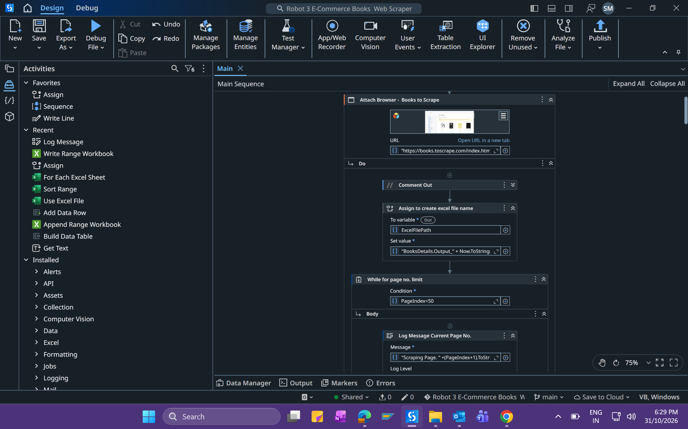
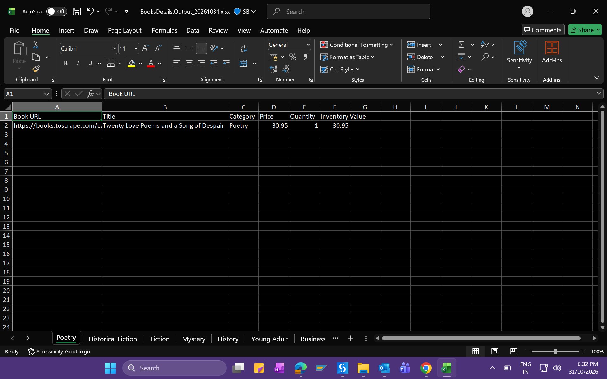

# Robot 3 – E-Commerce Books Web Scraper

## Overview
An RPA project developed using UiPath Studio to automate book data extraction from an e-commerce website, process product information, calculate inventory values, and generate Excel reports.

## Features
- Extract book titles, prices, availability, categories, and product URLs.
- Handle pagination using While and For Each loops.
- Clean extracted data using Split, Replace, and Trim.
- Convert text values into numeric data types.
- Calculate individual inventory values and total stock value.
- Create and populate DataTables dynamically.
- Export, append, and update data in Excel.
- Sort inventory data and organize reports across worksheets.
- Debug and validate workflows using UiPath Studio.

## Technologies Used
- UiPath Studio
- VB.NET
- DataTables
- Web Scraping and Table Extraction
- Excel Automation

## Project Screenshots

### Automation Workflow

### Excel Output

## Skills Gained
UiPath RPA, Web Scraping, Data Extraction, DataTable Manipulation, Excel Automation, VB.NET Expressions, String Manipulation, Data Processing, Pagination Handling, and Workflow Debugging.

## Author
**Shaik Mustaq**

GitHub: [Shaik-Mustaq](https://github.com/Shaik-Mustaq)

## Repository
[Robot 3 – E-Commerce Books Web Scraper](https://github.com/Shaik-Mustaq/Robot-3-E-Commerce-Books-Web-Scraper)
